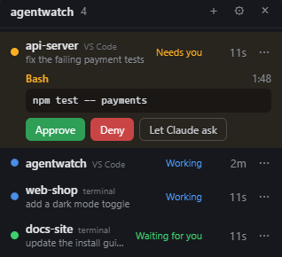
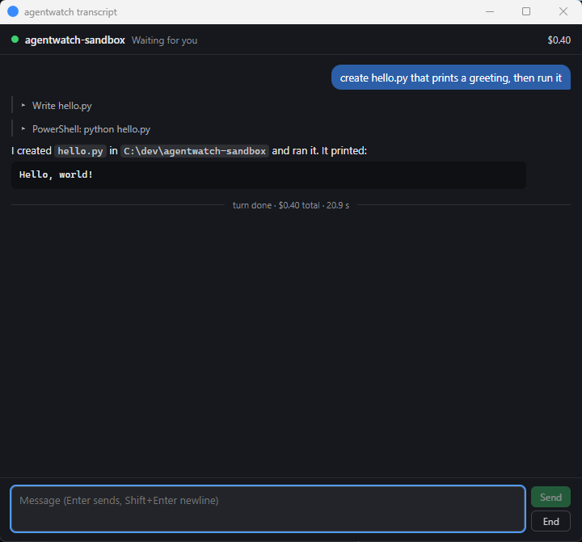

# agentwatch

A small always-on-top desktop widget that shows every Claude Code session on your machine, with its live state, and lets you answer from it.

It lists sessions from the terminal and from the VS Code extension in one place. For each session you can see whether Claude is working, waiting for you, or finished. From the widget you can:

- approve or deny permission prompts without switching windows;
- reply when Claude finishes a turn, which continues the session;
- launch a new headless agent in a folder and drive it from its own transcript window (text, expandable tool lines, running cost, Stop and End buttons);
- get desktop notifications when a session needs you or finishes, with per-session mute;
- keep it out of the way with a tray icon, opacity, click-through, edge snapping and start on login.





## Download and install

Get the latest build from the [releases page](https://github.com/Racso1230/agentwatch/releases/latest). The builds are not code-signed.

**Windows.** Run `agentwatch_<version>_x64-setup.exe`. Windows SmartScreen will warn that the app is from an unknown publisher: click "More info", then "Run anyway".

**Linux.** Either install the `.deb`:

```sh
sudo apt install ./agentwatch_*.deb
```

or make the AppImage executable and run it:

```sh
chmod +x agentwatch_*.AppImage
./agentwatch_*.AppImage
```

**Requirements.** [Claude Code](https://docs.claude.com/en/docs/claude-code) must be installed. To launch agents from the widget, the `claude` command must be on your PATH (or set `claude_path` in the config, see below).

## Connect to Claude Code

agentwatch learns about your sessions through Claude Code hooks. Nothing is changed until you agree:

1. Open the widget's Settings.
2. In "Claude Code connection", click Connect.
3. Read the consent text and click "Yes, add hooks".

Connect does exactly two things:

- It adds hook entries to `~/.claude/settings.json` for ten events (`SessionStart`, `SessionEnd`, `UserPromptSubmit`, `PreToolUse`, `PermissionRequest`, `PostToolUse`, `PostToolUseFailure`, `Notification`, `Stop`, `StopFailure`). Your existing hooks and settings are kept. Before writing, it saves a backup next to the file: `settings.json.agentwatch-backup-<timestamp>`.
- It copies a small hook program (about 200 KB) to `~/.agentwatch/bin/`, and the hook entries point at that copy.

Disconnect removes both the hook entries and the copied program. Only entries that agentwatch itself added are ever removed.

## How it works

```
Claude Code --runs--> agentwatch-hook --HTTP + token--> agentwatch widget
 (every hook event)   (tiny native exe)   127.0.0.1      (Tauri app)
```

Claude Code runs the hook program for each event and passes the event as JSON on stdin. The hook forwards it to a small HTTP server inside the widget. The server listens only on `127.0.0.1`, on a random port. The hook finds the port and a per-install token in `~/.agentwatch/endpoint.json`, and requests without the token are rejected.

**Fail open.** If the widget is closed or has crashed, the hook cannot connect, exits almost immediately, prints nothing and returns exit code 0, so Claude Code behaves exactly as if agentwatch was not installed. Nothing leaves your machine and there is no telemetry; the only network traffic is this loopback connection.

**Permission prompts.** When Claude asks to use a tool, the widget shows the request on the session's card. You can answer there or in Claude as usual, and the first answer wins. If nobody answers in the widget within 2 minutes (`permission_timeout_secs`), the card clears and Claude's own prompt decides. For agents launched from the widget, an unanswered card counts as a denial, because headless mode has no prompt of its own.

**Replies.** When Claude finishes a turn, the card offers a reply box for up to 30 minutes (`reply_max_wait_secs`). A reply is delivered to Claude as Stop-hook feedback, which wakes the session and continues it. Dismissing the box without a reply lets the session stop normally.

**Auto mode.** In Claude's `auto` permission mode, Claude Code fires no permission prompts, so there is nothing for the widget to answer. Sessions still show up with their state.

Per-session modes control how the widget treats prompts: Ask me (show every prompt), Auto-approve safe tools (read-only tools and allowlisted read-only shell commands are approved; chained, redirected and destructive commands always ask), Hands off, and Snooze.

## Configuration

### `~/.agentwatch/config.json`

Edit this file by hand. It is optional, and any missing key uses its default. A missing or invalid file also falls back to the defaults. Restart the widget after editing.

| Key                       | Default | Meaning                                                                                                                                       |
| ------------------------- | ------- | --------------------------------------------------------------------------------------------------------------------------------------------- |
| `permission_timeout_secs` | `120`   | How long a permission prompt waits for an answer in the widget before Claude's own prompt takes over.                                         |
| `reply_max_wait_secs`     | `1800`  | How long the reply box stays open after Claude finishes a turn.                                                                               |
| `safe_commands`           | below   | Shell commands that "Auto-approve safe tools" mode may approve, matched by prefix.                                                            |
| `claude_path`             | none    | Full path to the `claude` executable, if it is not on your PATH. Used when launching agents.                                                  |
| `claude_command`          | none    | Advanced and for tests: a whole command (program plus leading arguments) to run instead of `claude`, for example `["bun", "fake-claude.ts"]`. |

Default `safe_commands`: `git status`, `git diff`, `git log`, `git show`, `git branch`, `ls`, `dir`, `pwd`, `cat`, `type`, `Get-ChildItem`, `Get-Content`, `Get-Location`.

The hook gives up waiting after about 125 seconds and the hook entry has a 130 second timeout, so values of `permission_timeout_secs` above roughly 120 will not extend the wait.

Fixed timings live in `src-tauri/src/constants.rs`: a session shows as idle after 5 minutes of waiting, goes grey after 30 minutes of silence, and is removed 10 seconds after it ends or 2 hours after going stale.

### `~/.agentwatch/settings.json`

Written by the app when you change something in Settings: opacity (0.4 to 1.0, default 0.95), click-through (off), notify when a session needs you (on), notify when a session finishes (on), sound (off), start on login (off), snap to screen edges (on), and the recent folders list used by the launcher (up to 8). You normally do not edit it by hand. Click-through can only be turned off again from the tray icon.

Other files in `~/.agentwatch/`: `token` (the per-install secret), `endpoint.json` (port and token, rewritten on each start and removed on clean exit) and `bin/` (the hook program).

## Uninstall

- **Windows.** The uninstaller removes the agentwatch hooks from Claude Code's settings automatically. This does not happen when you upgrade, only on a real uninstall.
- **Linux.** Click Disconnect in Settings before removing the package or AppImage. If you already removed it, delete the agentwatch entries from `~/.claude/settings.json` (their command contains `agentwatch-hook`) or restore the `settings.json.agentwatch-backup-<timestamp>` file.

Optionally delete the `~/.agentwatch` folder as well.

## Building from source

Prerequisites: stable Rust, [Bun](https://bun.sh), and the [Tauri 2 system dependencies](https://v2.tauri.app/start/prerequisites/) for your OS. On Ubuntu, CI installs `libwebkit2gtk-4.1-dev libappindicator3-dev librsvg2-dev patchelf libgtk-3-dev libsoup-3.0-dev libjavascriptcoregtk-4.1-dev`.

```sh
bun install
bun run hook:build     # builds the hook binary (hook/target/release)
bun run tauri dev      # runs the app in development
bun run release:build  # builds the hook, then the installers (NSIS on Windows; .deb and AppImage on Linux)
```

Checks (the same ones CI runs):

```sh
bun run lint
bun run typecheck
bun run format:check
bun test

# in src-tauri/, and again for the hook with --manifest-path hook/Cargo.toml
cargo fmt --check
cargo clippy --all-targets -- -D warnings
cargo test
```

## Project structure

```
hook/                  The native hook program (agentwatch-hook), std-only networking
scripts/               prepare-hook.ts: builds the hook and places it for the installer
src/                   React + TypeScript UI (widget, settings, launcher, transcript window)
src-tauri/
  src/server.rs        Local HTTP server: /event, /permission, /stop
  src/sessions.rs      Session store and state machine
  src/hooks.rs         Connect / Disconnect: merges hooks into settings.json
  src/owned.rs         Headless claude processes launched by the widget
  src/policy.rs        Auto-approve rules for the per-session modes
  src/pending.rs       Held permission and reply requests
  src/transcript.rs    Transcript reading and watching
  src/config.rs        ~/.agentwatch/config.json
  src/settings.rs      ~/.agentwatch/settings.json
  src/endpoint.rs      Token and endpoint.json
  src/notify.rs, tray.rs, focus.rs, snap.rs, timers.rs
  windows/hooks.nsh    NSIS uninstall hook that disconnects from Claude Code
docs/                  Decisions, state model, hooks reference
prototype/             Early spike code kept as history (see its README)
```

## Design notes

The reasoning is written down in [docs/DECISIONS.md](docs/DECISIONS.md) and [docs/state-model.md](docs/state-model.md); [docs/hooks-reference.md](docs/hooks-reference.md) summarises the Claude Code hook events used.

- **Fail-open hook contract.** The hook drains stdin, prints to stdout only a permission decision and to stderr only a Stop reply, exits 0 in every other case including panics, and has a watchdog thread as a hard deadline. Claude Code's native `http` hooks were rejected because they print errors when the server is down.
- **Long-poll permission flow.** A `PermissionRequest` hook holds an HTTP request open while the widget shows the card. Answers, timeouts, session end and a dropped connection all clear the pending state, and a deny made inside Claude is picked up by watching the transcript.
- **`asyncRewake` replies.** The `Stop` hook runs asynchronously and, when you reply, exits with code 2 and your text on stderr, which wakes Claude without blocking the terminal.
- **Headless sessions.** Agents launched from the widget run `claude -p` with stream-JSON input and output. Messages are written to stdin, output becomes the transcript, and a stream-JSON control request interrupts the current turn while keeping the session open.

## Status

A personal project. It is tested on Windows. The Linux builds are produced by CI and have not been run on a Linux desktop by the author. macOS is not supported yet (CI runs the checks there, but no macOS build is released).

## License

[MIT](LICENSE), copyright 2026 Oscar Freeman.
