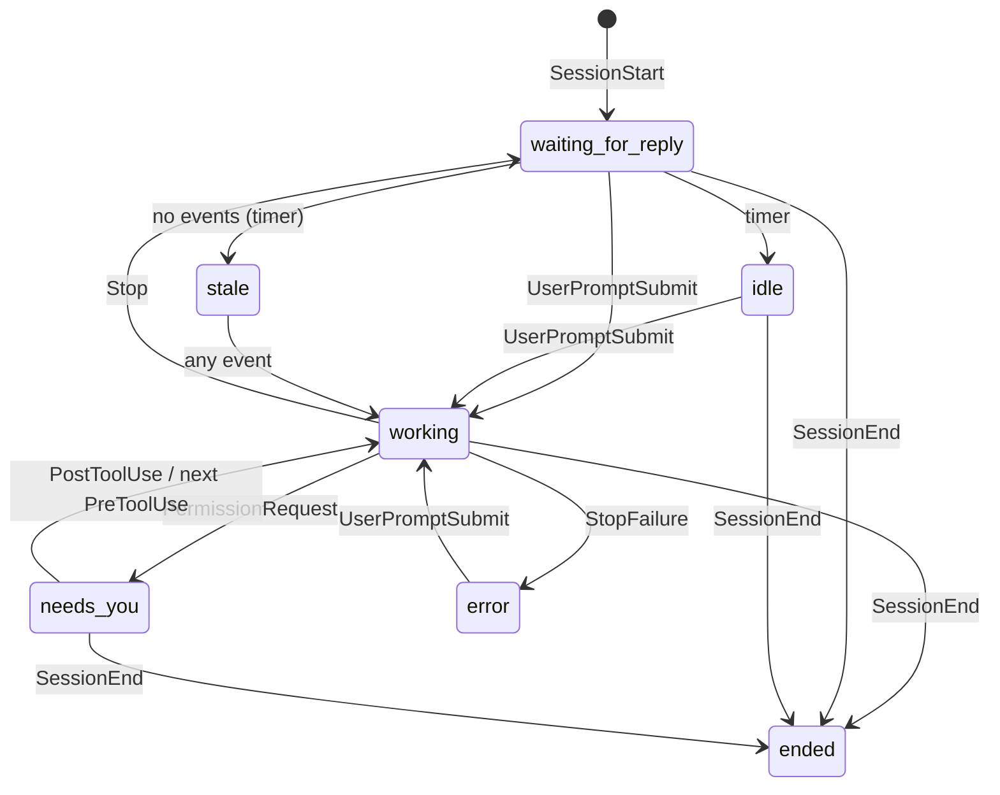

# Session state model

Derived from `docs/hooks-reference.md` and real payloads in `prototype/logs/events.jsonl` (3 sessions, Windows, terminal / `claude -p`, captured 2026-11-14). Key: `session_id`. Display name: basename of `cwd`.

## States

| State | Meaning |
|---|---|
| `working` | A turn is in progress (prompt submitted, tools running, model responding) |
| `needs-you` | Agent is blocked on the user: a permission prompt (later also AskUserQuestion / plan approval / elicitation) |
| `waiting-for-reply` | Turn finished (`Stop`); agent is waiting for the next instruction |
| `idle` | Waiting-for-reply for a long time with no activity (timer, see Stale handling) |
| `ended` | `SessionEnd` received; card is removed or greyed out shortly after |
| `error` (optional) | `StopFailure` (API error ended the turn); not yet seen in the log |
| `stale` (optional) | No events for a long time and no `SessionEnd` (crash/kill); not an event-driven state |

A fresh session starts in `waiting-for-reply` (a session with no prompt yet). It is shown as "started" if you want a distinct label.

## Transitions

Fields below are those actually present in the log unless marked (docs).

| Event (+ condition) | New state | Fields used |
|---|---|---|
| `SessionStart` | create card, `waiting-for-reply` | `session_id`, `cwd`, `source` = `"startup"` (docs: `resume`/`clear`/`compact`/`fork`); no `permission_mode` |
| `UserPromptSubmit` | `working` | `prompt`, `prompt_id`, `permission_mode` |
| `PreToolUse` | `working` (activity = tool) | `tool_name`, `tool_input`, `tool_use_id`, `effort.level` |
| `PermissionRequest` | `needs-you` | `tool_name`, `tool_input`, `permission_suggestions` (seen: `[{type:"setMode", mode:"acceptEdits", destination:"session"}]`); no `tool_use_id` |
| `Notification` with `notification_type = "permission_prompt"` | `needs-you` (fallback if no PermissionRequest was seen) | `message` = "Claude needs your permission"; no `permission_mode` |
| `PostToolUse` | `working` (clears `needs-you`) | `tool_name`, `tool_use_id`, `duration_ms` |
| `PostToolBatch` | `working` (no-op) | `tool_calls` |
| `MessageDisplay` | no state change | `final`, `delta`, `turn_id`; no `permission_mode` |
| `Stop` | `waiting-for-reply` | `last_assistant_message`, `stop_hook_active` (false in all), `background_tasks` (`[]`), `session_crons` (`[]`). If `background_tasks` non-empty (docs) show "paused on background work" |
| `SubagentStop` | **no change** (see quirks) | `agent_id`, `agent_type` (empty string), `agent_transcript_path` |
| `SessionEnd` | `ended` | `reason` seen: `"other"` (`claude -p`), `"prompt_input_exit"` (terminal exit); no `permission_mode` |
| `ConfigChange` | no state change | `source` = `"local_settings"`, `file_path` |
| timer: `waiting-for-reply` > N min | `idle` | placeholder, see below |
| timer: no events > M min | `stale` / remove | placeholder, see below |
| `StopFailure` (docs, unseen) | `error` | |
| `Notification` `idle_prompt` (docs, unseen) | `idle` | |

Any event for a known session after `stale`/`idle` revives it according to the table.

## Observed quirks

| Quirk | Evidence in log | Handling |
|---|---|---|
| `SubagentStop` fires 2-3 s after the main `Stop` in interactive sessions (a background helper) | auto session: Stop 15:21:06.129 then SubagentStop 15:21:08.226 (+2.1 s); default session: Stop 15:25:29.619 then SubagentStop 15:25:32.026 (+2.4 s). Not present in the `claude -p` run. It carries the SAME `session_id` as the parent | Never change main session state, never create a card. It has `agent_id` (e.g. `abf899e1da128b117`) but `agent_type` is an empty string `""`. Rule: any event with `agent_id` is subagent context and must not move the parent state; `SubagentStop` is ignored for state |
| `Notification(permission_prompt)` arrives ~6 s after `PermissionRequest` | 15:25:17.023 -> 15:25:23.023 (exactly 6.0 s) | Treat as confirmation only; the card must already be `needs-you` from `PermissionRequest`. Do not rely on it for timing |
| `PermissionRequest` has no `tool_use_id` | confirmed | Correlate with the preceding `PreToolUse` (same `session_id` + `tool_name`, 0.15 s earlier) and the following `PostToolUse` (same `tool_name`/`tool_input`) by order |
| `PreToolUse` fires BEFORE `PermissionRequest` | 15:25:16.870 PreToolUse, 15:25:17.023 PermissionRequest | `PreToolUse` alone does not mean the tool is running; wait for `PostToolUse`. A `PreToolUse` with no following `PermissionRequest` within a short window = auto-allowed |
| `SessionStart` / `SessionEnd` lack `permission_mode` (also `Notification`, `MessageDisplay`, `ConfigChange`) | confirmed | Take the mode from the last event that has one |
| Windows backslash paths | `cwd`, `transcript_path`, `file_path` all `C:\\...` | Treat as opaque; normalise separators only for the display basename (split on both `\` and `/`) |
| `permission_mode` can be `"auto"` | session 2 (all events `auto`) | No `PermissionRequest` will ever arrive in that mode (none did); the widget has nothing to answer. `needs-you` never triggers there |
| User answered the prompt in the terminal after ~10 s | PermissionRequest 15:25:17.0 -> PostToolUse 15:25:27.7 | `PostToolUse` clears `needs-you`, whoever answered |
| Parent `pid` differs per event | e.g. 23532, 11048, 27428 | Never use pid (ADR-7). Shared `cwd` between sessions is possible |
| Extra events beyond the proposal | `PostToolBatch`, `MessageDisplay`, `ConfigChange` appear in the log | Subscribe only to what is needed; these add no state info |
| `SessionEnd` not seen for session 3 | the log ends with `ConfigChange` at 15:26:22 | Session was probably still open or killed; supports a stale timer |
| `SessionEnd` follows `Stop` within 0.2 s in `-p` | Stop 15:12:54.097, SessionEnd 15:12:54.281 | `-p` sessions are short-lived cards; consider hiding or fast-dropping them |

## Stale handling (Phase 1 open question for the user)

Placeholders, to be decided with the user:

| Rule | Placeholder |
|---|---|
| `waiting-for-reply` -> `idle` | after N = 5 min without events (or on `Notification` `idle_prompt`, ~60 s after Stop) |
| `idle`/any state -> greyed `stale` | after M = 30 min without any event |
| Drop card | on `SessionEnd` (after a short grace, e.g. 10 s), or after 2 h stale |
| `needs-you` with no events | do not time out locally; leave until `PostToolUse`/`Stop`/`SessionEnd` or stale rule |

## Still unverified

- VS Code extension behaviour: no VS Code session captured yet (first attempt ran in the wrong workspace so project hooks did not load). Open: do all events fire, does `PermissionRequest` fire, `permission_mode` values, `SessionEnd` on tab/panel close.
- `Notification` `idle_prompt` (no session sat idle for 60 s with the hook active).
- Interrupted turns (Esc): docs say `Stop` does not fire; what, if anything, fires instead is unknown.
- `AskUserQuestion` and `ExitPlanMode` (plan approval) payloads, and whether `PreToolUse`, `PermissionRequest` or both fire.
- Race between answering in the terminal vs the widget (hook pending while the user answers in the terminal).
- Real `SubagentStart` and non-empty `agent_type` (the only subagent event seen had `agent_type: ""`; probably an internal helper, not a user Task call).
- `StopFailure`, `PermissionDenied`, `Elicitation`, `resume`/`clear`/`compact` `SessionStart` sources.
- `permission_suggestions` of type `addRules` (only `setMode` seen).
